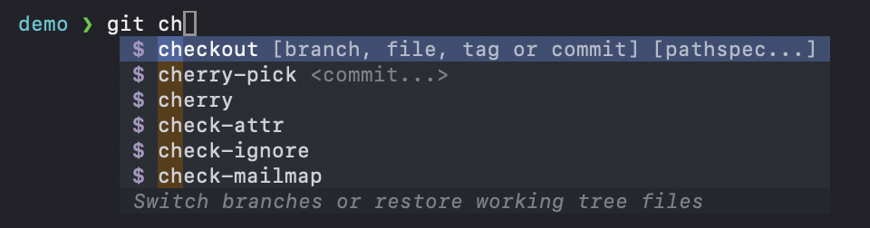
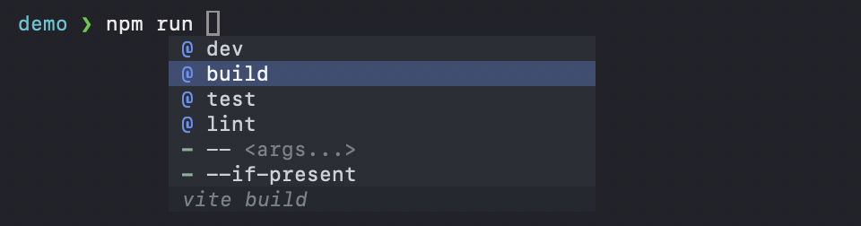
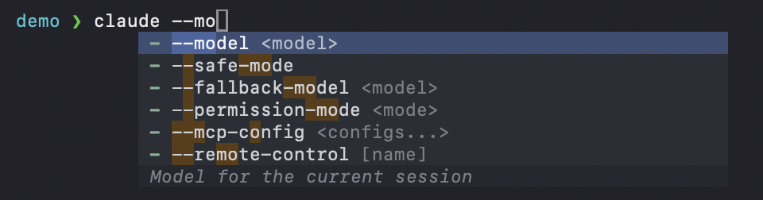

<h1 align="center">fac</h1>

<p align="center"><strong>Fast autocomplete for the macOS terminal.</strong></p>

<p align="center">
  
</p>

Type a command and fac shows a popup of what can come next: subcommands, options, git branches, npm scripts, files and your history, each with a short description. It works in any terminal, with zsh, bash and fish, and it draws in about 3 ms.

fac is a replacement for Fig's autocomplete, which stopped working. It keeps what made Fig good (the same popup, keys and completions for about 700 commands) and runs as a single small program inside your terminal: no app, no account, no window permissions.

- ⚡ **Fast:** the popup is on screen about 3 ms after your keypress.
- 🧠 **Knows your commands:** about 700 of them, AI coding tools included.
- 🖥️ **Every terminal:** Terminal.app, iTerm2, Ghostty, VS Code and Zed.
- 🐚 **zsh, bash and fish.**
- 🎨 **Fits your terminal's colours,** dark or light.
- 🧩 **Add your own commands** in a few lines.
- 📦 **One command to install,** one to set up.

## Install

    brew install itaikeren/tap/fac
    fac init

`fac init` asks which terminals should start with fac (all of them are ticked) and sets them up. Open a new terminal window and type `git ` to see it.

> [!NOTE]
> fac needs macOS, and zsh, bash 5.3+ or fish 4.3+ as your shell. With an older bash or fish (macOS's own bash is 3.2), fac starts the shell without autocomplete.

<details>
<summary>Build it from source instead</summary>

With Rust 1.99 or newer:

    cargo install --git https://github.com/itaikeren/fac
    fac init

</details>

### What `fac init` does

It adds a short, clearly marked block to the top of your shell's startup file: `~/.zshrc` (and `~/.zprofile`, if you have one) for zsh; your bash login file and `~/.bashrc` for bash; a file of its own, `conf.d/00-fac.fish`, for fish. When a new window opens in one of the terminals you ticked, that block starts fac. Nothing else in the file changes, a copy of the file as it was is kept next to it (`~/.zshrc.fac-backup`), and your terminals' own settings are not touched.

| Command | What it does |
|---|---|
| `fac init` | Choose the terminals again; run it as often as you like |
| `fac disable` | Turn fac off in new windows, keeping your choices |
| `fac enable` | Turn it back on |
| `fac uninstall` | Remove the block, leaving the file exactly as it was |
| `fac doctor` | Check the setup and show what is wrong, if anything |

If fac ever fails to start, new windows open your plain shell instead, with a one-line note. `fac doctor` shows why, and turns fac back on once nothing is wrong.

To try fac once without setting anything up, just run `fac` in any terminal. Prefer to set a terminal up by hand? See [docs/terminals.md](docs/terminals.md).

### Upgrade

    brew upgrade fac

New windows get the new version; `fac init` does not need to run again.

## Using it

| Key | What it does |
|---|---|
| Just type | The popup opens as you type, with nothing selected |
| Down / Up | Select a suggestion |
| Tab | Insert the selected suggestion, or the top one |
| Enter | Insert the selected suggestion; with nothing selected, run the line |
| Esc | Close the popup until the word you are typing changes |

The line at the bottom of the popup describes the selected suggestion.

<p align="center">
  
</p>

## Features

- **Knows your commands.** About 700 commands out of the box (git, npm, docker, kubectl, brew, cargo, ssh and many more), with their subcommands, options and arguments, and the AI coding tools Fig never had: Claude Code, Codex, Gemini CLI and others. Live suggestions where it counts: your git branches, your `package.json` scripts, your Docker containers.
- **Falls back gracefully.** For a command fac has no description of, it asks your shell's own completion system, then offers history and files.
- **Finds what you mean.** Suggestions that start with what you typed come first, close (fuzzy) matches below them, and the things you pick most recently rise to the top.
- **Every terminal.** Terminal.app, iTerm2, Ghostty, VS Code and Zed. The popup is drawn inside the terminal itself, so it looks and behaves the same everywhere.
- **zsh, bash and fish.** The same popup and keys in all three, including vi mode, paste, and text in any language (Hebrew, emoji).
- **Fits your terminal's colours.** The popup reads your terminal's background and accent colour, so it matches light and dark themes with no setup. Or make your own theme.
- **Your own commands.** Describe your own tools in a few lines of TypeScript, JavaScript or JSON, and they are live at your next prompt.
- **Stays out of the way.** Keys are only taken while the popup is open. fac hides itself in full-screen programs (vim, less) and steps aside in Warp, which has its own autocomplete.

<p align="center">
  
</p>

## Speed

Speed was the first goal: the popup should appear with the letter you typed, not after it. A 60 Hz screen draws a new frame every 16.7 ms; fac aims for under 5 ms from your keypress to the popup on screen.

Measured live with fac's built-in timers (`FAC_STATS=1`), for the slower keystrokes (the 95th percentile):

| Terminal | zsh | bash | fish |
|---|---|---|---|
| Ghostty | 3.3 ms | 3.4 ms | 3.0 ms |
| Terminal.app | 5.7 ms | | |
| iTerm2 | 6.0 ms | | |

A typical keystroke in Terminal.app and iTerm2 takes 3.4 to 3.9 ms.

How it stays fast: fac is written in Rust; everything it suggests is held in memory, so nothing is started on a keystroke; slow sources such as git branches run once, in the background, and join the popup when they are ready; and the whole popup goes to the terminal in one write.

## Make it yours

fac reads `~/.config/fac/config.toml` when it starts. Every setting is optional:

```toml
theme = "default"                # or the name of your own theme
icons = "plain"                  # "plain", "nerd" (Nerd Font icons) or "none"
fuzzy = true                     # close matches below the exact ones
sort = "recent"                  # "recent" or "alphabetical"
history = true                   # suggest lines from your history
description_popout_key = ""      # a key such as "ctrl+k" shows the full description beside the popup
generator_timeout_ms = 5000      # how long live suggestions (git branches...) may take
disable_for_commands = []        # commands fac should leave alone, such as ["ssh"]
```

A mistake in the file never stops fac: it uses the defaults and notes the problem in its log. More in [docs/configuration.md](docs/configuration.md).

### Themes

The `default` theme takes its colours from your terminal. To make your own:

1. `fac theme new mine` writes a starting theme to `~/.config/fac/themes/mine.json` (add `--light` for light colours).
2. Change the colours.
3. Set `theme = "mine"` in `config.toml`.

Theme files use Fig's theme format, so Fig themes work too. The keys are in [docs/themes.md](docs/themes.md).

## Add your own commands

Teach fac a command it doesn't know, such as your company's CLI:

    fac spec new mytool

This writes `~/.config/fac/specs/mytool.ts`, a commented starting point:

```ts
const completionSpec: Fig.Spec = {
  name: "mytool",
  description: "Deploy and manage my apps",
  subcommands: [
    {
      name: "deploy",
      description: "Deploy an app",
      args: { name: "app" },
    },
  ],
  options: [{ name: ["-v", "--verbose"], description: "Print more" }],
};
export default completionSpec;
```

Save it and type `mytool ` at your next prompt: no restart needed. Your editor gets completion and type checking for the file with no npm install. Suggestions can also come from a command you run (a list of your apps, say).

- `fac spec check mytool` shows what fac read from the file, or exactly what is wrong and where.
- `fac spec list` lists your specs.
- Prefer no code? `fac spec new mytool --json` writes the same in plain JSON. `--js` gives JavaScript.

A spec of yours with the name of a built-in one replaces it. Specs follow Fig's format, so Fig's docs and its specs are good examples. More in [docs/specs.md](docs/specs.md).

## Turning it off

- `fac disable` keeps new windows plain until `fac enable`.
- `FAC_DISABLE=1` in the environment starts the shell plain, once.
- fac also steps aside on its own in Warp and in full-screen programs.

## Uninstall

    fac uninstall
    brew uninstall fac

`fac uninstall` removes fac's block from your startup files and lists the folders fac keeps: your settings and specs in `~/.config/fac`, the ranking data in `~/Library/Application Support/fac`, logs in `~/Library/Logs/fac` and a cache in `~/Library/Caches/fac`. Delete them too for a clean slate.

## Help and more

- [docs/terminals.md](docs/terminals.md): tested terminal versions, setting a terminal up by hand, and keeping your terminal's shell integration.
- [docs/known-limits.md](docs/known-limits.md): the cases fac does not handle yet.
- [docs/configuration.md](docs/configuration.md): every setting and environment variable.
- Something wrong? Run `fac doctor` first: it checks your shell, the startup setup, your settings and specs, and shows the last warnings from the log (`~/Library/Logs/fac/fac.log`; `FAC_LOG=debug` for more). Open an issue with its output and what you typed and saw.

## Contributing

Pull requests are welcome: new specs and fixes to existing ones most of all (see [docs/specs.md](docs/specs.md)).

    git clone https://github.com/itaikeren/fac && cd fac
    cargo build --release          # target/release/fac
    ./tools/test-shells.sh         # once: the bash and fish the tests use, into target/
    cargo test --tests

The tests run fac inside a headless terminal and check the screen after every key, so a popup glitch shows up as a failing test.

Releases: tag `vX.Y.Z` (the same version as in Cargo.toml) and push the tag; the release workflow builds and uploads the macOS archives, and `tools/release/formula.sh X.Y.Z` writes the Homebrew formula from them.

## Thanks

fac stands on the work of others:

- **[Fig](https://github.com/withfig/autocomplete)**, whose open-source command descriptions give fac its knowledge of about 700 commands, and whose autocomplete (open-sourced as [Amazon Q Developer CLI](https://github.com/aws/amazon-q-developer-cli)) showed how it should feel. fac's handling of those descriptions follows Fig's own logic.
- **[nucleo](https://github.com/helix-editor/nucleo)**, the Helix editor's fuzzy matcher.
- **[QuickJS-NG](https://github.com/quickjs-ng/quickjs)** and **[rquickjs](https://github.com/DelSkayn/rquickjs)**, which run the JavaScript in command descriptions.
- **[Oxc](https://github.com/oxc-project/oxc)**, which reads your TypeScript specs.

Their licences, and those of every other library fac is built with, are in [THIRD_PARTY_NOTICES.md](THIRD_PARTY_NOTICES.md).

## Licence

MIT.
